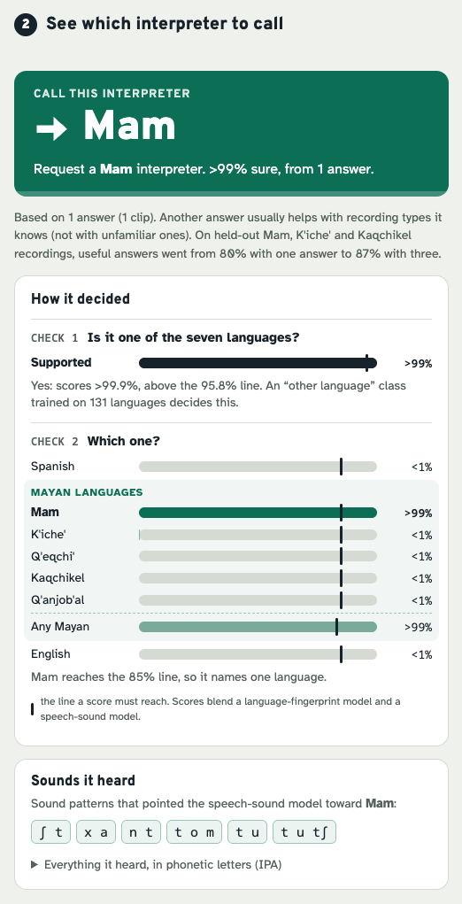

# Which Interpreter? Telling a clinic which interpreter to call for Guatemalan Mayan speakers

**Track:** Languages
**Team:** [REPLACE before submitting: every member's full name]

## The problem
In 2016, Mam and K'iche', Mayan languages from Guatemala, were the 9th and 10th most common languages in US immigration courts, ahead of French ([DOJ EOIR, Table 7](https://www.justice.gov/eoir/page/file/fysb16/download)). Front-desk staff often can't tell them from Spanish, so a Mayan speaker gets a Spanish interpreter, which delays care or leaves them unable to explain their symptoms or case ([CMS-hosted brief](https://cms.gov/files/document/growing-gap-health-equity-indigenous-language-justicepdf.pdf); [CAP, 2023](https://www.americanprogress.org/article/improving-language-access-in-the-u-s-asylum-system/)). Off-the-shelf tools don't fix this: Meta's MMS language identifier sends 24% of Mayan storybook clips to Spanish.

## What we built
A laptop web app for clinic and legal-aid intake. Staff record up to three short answers (name, town, reason for visit) in the language the person speaks at home. In under a second it says "Call a **Mam** interpreter" (or Spanish, K'iche', Q'eqchi', Kaqchikel, Q'anjob'al), "English: no interpreter needed", "A Mayan language: try K'iche', then Kaqchikel", "Not a supported language" or "Not sure", and shows how it decided. Audio never leaves the laptop. Until its Spanish weakness is fixed (failure 1 below), it's best used as a second opinion when Spanish isn't working.

*Interpreter access only: a person always confirms with the speaker. Not for deciding where someone is from, or for immigration or asylum decisions. This project is a prototype and is not medical advice.*

## What we added
Our own idea. The only Mayan-vs-Spanish speech study we found covers Yucatec Maya alone ([Buenfil Aguilar et al., 2025](https://doi.org/10.1007/978-3-031-97907-1_9)).
- **Own user:** intake staff choosing an interpreter, so the tool can say "try two" or "I don't know" instead of guessing.
- **Own data:** 27,169 clips in 207 languages from 17 public datasets, audited by us. 57% of SIL's "Q'eqchi'" clips came from a book titled *Stxolil q'anej Q'anjob'al*; we relabelled them Q'anjob'al.
- **Own question:** does it hold up on recordings and languages it never saw? We froze the models, then scored each blind test once.

## How it works
**Data:** SIL Bloom Library storybooks (9,672 clips, 231 books, our 7 languages), plus K'iche' course audio, Mam radio, a Kaqchikel podcast and read Spanish and English, split by recording or speaker (half train, half test). 194 other languages (131 train, 26 tune, 37 test) teach it to decline. We removed 606 silent, duplicated or mislabelled clips, and never split by clip: a random split scores 0.98 instead of 0.79 because the model memorises narrators.

**Model:** two pretrained Meta speech models, used unchanged, turn each clip into numbers: a "language fingerprint" (`mms-lid-4017`) and the speech sounds it hears (a speech-sound recogniser). With only 231 books, we train small classifiers (logistic regression) on each and blend them 50/50. An extra "other language" class, trained on 131 languages, gives "Not a supported language". Several answers are combined into one decision.

## Results
**Mayan clips sent to a Spanish interpreter, on storybooks it never trained on: always-Spanish 100%, Meta's MMS used as-is 24%, ours 4%. When it isn't sure, it says so:** with the full app on new recordings and in both blind tests, 0–1% of Mayan clips went to a Spanish interpreter and under 1% of Spanish clips went to any other interpreter. Of 100 Mam radio clips from recordings it never trained on (same radio series as the training half), it said "call a Mam interpreter" 84 times, "try Mam, then …" 4 times, "not supported" 11 times and "not sure" or another Mayan language once. It sent **none** to Spanish.

| Test (95% range: resampling whole books, recordings or languages) | Baseline | Ours |
|---|---|---|
| Mayan sent to Spanish, unseen storybooks¹ | always-Spanish 100% · MMS 24% | **4.0%** |
| Overall score, 7 languages, unseen storybooks¹ (macro-F1, 0–1) | MMS 0.55² | **0.79** (0.64–0.86) |
| Correct per language, unseen storybooks¹: Spa / Mam / K'iche' / Q'eqchi' / Kaqchikel / Q'anjob'al / Eng | MMS 99 / 60 / 50 / 66 / 47 / 60 / 0%² | 97 / 46⁵ / 56 / 95 / 80 / 90 / 98% |
| Useful answer³, new recordings, 1 → 3 answers: Mam / K'iche' / Kaqchikel / Spanish | always-Spanish 0 / 0 / 0 / 100% | 89→91 / 82→92 / 71→78 / 79→92% |
| Blind test 1⁶: telling never-heard languages from ours⁴ (AUROC) | max-probability 0.92 | **0.98** (99.7% declined) |
| Blind tests⁶: Spanish correctly named (Argentina / audiobooks / radio / parliament) | — | 88 / 64 / 13 / 9% (weak) |

¹ The app's fingerprint classifier, retrained with those storybooks held out; other rows use the full app. ² MMS had no English option (scored 0); on the other six it gets ≥0.64. ³ The right interpreter, or a "try two" that includes it. ⁴ AUROC: 0.5 = chance, 1 = perfect. Mostly parliament audio; within parliament clips alone it is still 0.98. ⁵ 69% of Mam storybook clips are one book; held out, it scores 32%, while the other Mam books score 75–98%. Misses go to other Mayan languages; 1.6% go to Spanish. ⁶ Radio, parliament and AUROC: blind test 1, scored with our first frozen models (the final app gets 18 / 10% and 0.93 vs 0.98 on those clips). Argentina and audiobooks: blind test 2, final app.

| Clip it never trained on | Correct answer | Our answer |
|---|---|---|
| Kaqchikel, podcast | Kaqchikel interpreter | Kaqchikel interpreter ✓ |
| Mam, radio | Mam interpreter | Mayan: try Mam, then Kaqchikel ✓ |
| Spanish, parliament | Spanish interpreter | Not a supported language ✗ |
| Sakapulteko (Mayan, not covered) | Not a supported language | Kaqchikel interpreter ✗ |

**Where it fails, and why we think so:**
1. **Spanish recorded unlike our training audio.** In blind test 1 the "I don't know" check rejected 87–91% of radio and parliament Spanish, though the classifier underneath was right on 93–99% of them. Almost none got a wrong interpreter, but it slows Spanish speakers down. We think it learned recording conditions as part of each language: a simple classifier can tell our storybook Spanish from FLEURS Spanish almost perfectly. Text-to-speech voices fail the same way: Spanish was named in only 4 of 42 single answers, though the classifier underneath picked Spanish in 49 of the 51 declined runs, while English passed 21 of 21 and French, Portuguese and Mandarin were all declined ([`synthetic_voices.md`](results/synthetic_voices.md)).
2. **Close Mayan relatives** (Tz'utujil, Sipakapense, Sakapulteko, Poqomam) are declined only 22–44% of the time. Most of the rest get "try two" or one of our Mayan languages; only 0–1.5% go to Spanish. Our "other" class only heard Mexican Mayan languages.
3. **New sources need data.** Storybooks alone gave 20–42% on course, radio and podcast audio; ten recordings per source gave 81–88% (an upper bound: same series, probably the same narrators). In blind test 1, one Kaqchikel and one K'iche' speaker (8 clips each) got 13% and 25% useful answers, with none sent to Spanish.
4. **Didn't help enough to keep:** noise augmentation, and removing recording-source cues (one method lifted K'iche' course audio from 9% to 24% but hurt Spanish).
5. **No native Mayan speaker has reviewed our outputs**; labels come from the publishers. [Team: own-voice test (English, plus any unsupported language you speak) from `results/own_voice.md` here.]

More examples: [`side_by_side.md`](results/side_by_side.md). Full tables: [`results/`](results/). `make all` reproduces everything (`make download` fetches the data, which isn't in the repo).

## What we'd do next
1. Record consenting speakers of unscripted Spanish and each Mayan language at a real intake desk, and retune the "I don't know" check on that audio.
2. Partner with an interpreter agency for native-speaker review of errors and for Akateko, Ixil and more Q'anjob'al recordings.

## Sources
- **Problem:** [DOJ EOIR FY2016 Statistics Yearbook](https://www.justice.gov/eoir/page/file/fysb16/download) (Table 7), [A Growing Gap in Health Equity: Indigenous Language Justice](https://cms.gov/files/document/growing-gap-health-equity-indigenous-language-justicepdf.pdf) (Avantpage Translations, hosted by CMS), [Center for American Progress, 2023](https://www.americanprogress.org/article/improving-language-access-in-the-u-s-asylum-system/).
- **Training data:**
  - [SIL Bloom-Speech](https://huggingface.co/datasets/sil-ai/bloom-speech) (SIL International; CC BY / BY-SA / BY-NC / BY-NC-SA, ND books excluded)
  - [FLEURS](https://huggingface.co/datasets/google/fleurs) (CC-BY)
  - [UT COERLL K'iche'](https://tzij.coerll.utexas.edu/) (CC-BY)
  - [Tzijonel podcast](https://archive.org/details/5.-chwa-nima-abaj) (CC-BY-NC-ND; half the episodes used in training)
  - [Tachiwin](https://huggingface.co/datasets/tachiwin/tachiwin_multilingual_audio) (INPI Mexico broadcasts; no licence stated, non-commercial research use)
  - [Omnilingual ASR](https://huggingface.co/datasets/facebook/omnilingual-asr-corpus) (CC-BY)
  - [Chuj corpus, S. Lett](https://zenodo.org/records/13826879) (CC-BY)
  - Google Spanish: [Chile](https://huggingface.co/datasets/ylacombe/google-chilean-spanish) and [Colombia](https://huggingface.co/datasets/ylacombe/google-colombian-spanish) (CC-BY-SA)
  - [LibriSpeech](https://huggingface.co/datasets/openslr/librispeech_asr) (CC-BY)
- **Blind tests only:**
  - [VoxPopuli](https://huggingface.co/datasets/facebook/voxpopuli) (CC0)
  - [CIEMPIESS](https://huggingface.co/datasets/ciempiess/ciempiess_test) (CC-BY-SA)
  - [EdAcc](https://huggingface.co/datasets/edinburghcstr/edacc) (CC-BY-SA)
  - [MLS Spanish](https://huggingface.co/datasets/facebook/multilingual_librispeech) (CC-BY)
  - [People's Speech](https://huggingface.co/datasets/MLCommons/peoples_speech) (CC-BY)
  - [Google Spanish, Argentina](https://huggingface.co/datasets/ylacombe/google-argentinian-spanish) (CC-BY-SA)
  - [Wikitongues](https://wikitongues.org) and [Lingua Libre](https://lingualibre.org) (CC-BY-SA)
- **Noise:** [RIRS_NOISES](https://www.openslr.org/28/) (Apache-2.0), [ESC-50](https://github.com/karolpiczak/ESC-50) (CC-BY-NC), [DEMAND](https://zenodo.org/records/1227121) (CC-BY-SA)
- **Models:** [`facebook/mms-lid-4017`](https://huggingface.co/facebook/mms-lid-4017) (CC-BY-NC), [`facebook/wav2vec2-xlsr-53-espeak-cv-ft`](https://huggingface.co/facebook/wav2vec2-xlsr-53-espeak-cv-ft) (Apache-2.0). Some sources are non-commercial, so this demo is non-commercial only.
- **Prior work:** [MMS (Pratap et al., 2023)](https://arxiv.org/abs/2305.13516), [outlier exposure (Hendrycks et al., 2019)](https://arxiv.org/abs/1812.04606), [LEACE (Belrose et al., 2023)](https://arxiv.org/abs/2306.03819).
- **Software:** PyTorch, Transformers, scikit-learn, SciPy, pandas, ffmpeg, Gradio.
- **Tutorials:** none, library documentation only. [Team: confirm.]
- **AI tools:** [Claude Code](https://www.anthropic.com/claude-code) (Anthropic) wrote much of the code, ran experiments and helped research and draft, under our direction. Every result comes from this repository's scripts and `results/` files, and the team can explain each step.
